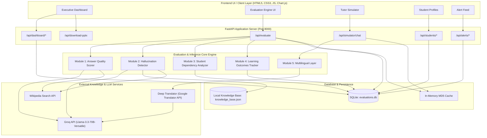

# VEXUS: AI-Powered Multilingual Tutoring & Evaluation Platform
## Complete System Architecture, Prediction Algorithms, and Technical Specification

---

## 1. Executive Summary & Core Purpose

**Vexus** is an enterprise-grade AI tutoring and evaluation platform designed to assess, audit, and enhance AI pedagogical assistants across five core dimensions:
1. **Answer Quality (Pedagogical Efficacy)**
2. **Hallucination Risk (Factuality & Safety)**
3. **Student Dependency (Over-reliance Telemetry)**
4. **Learning Outcomes (Knowledge Progression & Retention)**
5. **Multilingual Parity (Equitable Cross-Lingual Tutoring)**

The platform provides a dual-interface system:
- **Interactive AI Tutor Simulator**: A real-time conversational tutor providing pedagogical, grade-appropriate, multilingual assistance.
- **Evaluation Dashboard & Analytics Suite**: An automated evaluation engine providing telemetry, risk detection, student growth tracking, and actionable intervention alerts.

---

## 2. End-to-End System Architecture



---

## 3. Data Lifecycle: Ingestion, Inference & Return

### 3.1 Data Ingestion Flow
1. **User Request**: The student or teacher enters inputs via the Web Dashboard (Question, AI Response, Subject, Grade Level, Student ID, Ground Truth).
2. **Client Validation & Serialization**: The frontend (`api.js`) creates a structured JSON payload and sends an asynchronous HTTP POST to `/api/evaluate` or `/api/simulator/chat`.
3. **Language Ingestion & Normalization**:
   - `langdetect` detects the ISO language code (e.g., `en`, `hi`, `fr`, `es`).
   - If non-English, `deep-translator` translates the text to standard English for LLM evaluation.
4. **Fast-Path In-Memory Cache**:
   - Computes an MD5 checksum of the request:
     $$\text{CacheKey} = \text{MD5}(\text{JSON}(\text{RequestPayload}))$$
   - Returns cached evaluation immediately if available, preventing unnecessary external API calls.

### 3.2 Evaluation Execution Flow
1. **Dynamic Knowledge Grounding**: If ground truth is not supplied, the system queries the **Wikipedia Search API** to fetch top summary sentences as reference facts.
2. **LLM-as-a-Judge Evaluation**: Groq API (`llama-3.3-70b-versatile`) evaluates factual accuracy, completeness, clarity, pedagogical value, and hallucination indicators with strict JSON output schemas.
3. **Deterministic Student Telemetry**:
   - Historical sessions are pulled from `evaluations.db` to calculate dependency indices and learning progression.
4. **Safety & Risk Categorization**: If hallucination risk or student dependency exceeds configured safety thresholds, system alerts are generated and stored in the database.

### 3.3 Return Flow to User
1. **Pydantic Response Validation**: Data is serialized to strongly-typed models (`EvaluationResult`, `DashboardOverview`, `ChatResponse`).
2. **Database Persistence**: Session records, evaluation scores, and alerts are committed to SQLite.
3. **Interactive UI Rendering**: The frontend renders radar score breakdowns, A–F letter grades, time-series charts, and actionable recommendations.

---

## 4. Evaluation Modules & Mathematical Prediction Models

### Module 1: Answer Quality Scorer (`answer_quality.py`)
Assesses response quality across 5 pedagogical dimensions (each scored 0–100):

$$\text{Quality Score} = (0.30 \times \text{Accuracy}) + (0.25 \times \text{Completeness}) + (0.20 \times \text{Clarity}) + (0.15 \times \text{Pedagogical Value}) + (0.10 \times \text{Age Appropriateness})$$

* **Factual Accuracy (30%)**: Correctness compared against ground truth and domain knowledge.
* **Completeness (25%)**: Extent to which all facets of the student's question are answered.
* **Clarity (20%)**: Structural elegance, readability, and absence of confusing jargon.
* **Pedagogical Value (15%)**: Use of analogies, intuitive explanations, and conceptual scaffolding.
* **Age-Appropriateness (10%)**: Vocabulary and cognitive suitability for the specified grade level.

---

### Module 2: Hallucination Detector (`hallucination_detector.py`)
Computes the probability of factual hallucinations on a 0.0 to 1.0 scale:

$$\text{Hallucination Risk} = (0.40 \times \text{Fabrication}) + (0.20 \times \text{Citation}) + (0.20 \times \text{Formula}) + (0.20 \times \text{Confidence})$$

* **Fabrication Score (40%)**: Likelihood of invented facts, dates, entities, or concepts.
* **Citation Score (20%)**: Presence of unverified or nonexistent academic citations.
* **Formula Score (20%)**: Mathematical, scientific, or logical syntax inaccuracies.
* **Confidence Score (20%)**: Absolutist or uncalibrated language stating uncertain/incorrect claims as facts.
* **Flagged Claims**: Returns up to 10 specific flagged sentences with explanatory critiques.

---

### Module 3: Student Dependency Analyzer (`dependency_analyzer.py`)
Monitors student reliance on AI assistance using behavioral telemetry (0.0 to 1.0 scale):

$$\text{Dependency Index} = (0.25 \times QF) + (0.30 \times CPR) + (0.25 \times SAT) + (0.20 \times SB)$$

* **Query Frequency ($QF$)**: Number of queries submitted within the last 24 hours:
  $$QF = \min\left(\frac{\text{Queries in 24h}}{20}, 1.0\right)$$
* **Copy-Paste Ratio ($CPR$)**: Average **Jaccard Similarity** of word tokens between consecutive sessions:
  $$CPR = \frac{|A \cap B|}{|A \cup B|}$$
* **Self-Attempt Time ($SAT$)**: Average time delta ($\Delta t$) between consecutive queries in minutes:
  $$SAT = \begin{cases} 1.0 & \text{if } \Delta t \le 2\text{ min} \\ 0.0 & \text{if } \Delta t \ge 60\text{ min} \\ 1.0 - \frac{\Delta t - 2}{58} & \text{otherwise} \end{cases}$$
* **Scaffolding Bypass ($SB$)**: Ratio of direct solution requests ("give me answer", "do my homework") vs. learning prompts ("explain why", "step-by-step", "hint"):
  $$SB = \min\left(\frac{N_{\text{direct}}}{N_{\text{direct}} + N_{\text{learning}} + 1}, 1.0\right)$$
* **Alert Classifications**:
  * **Healthy**: $\text{Index} < 0.30$
  * **Caution**: $0.30 \le \text{Index} < 0.60$
  * **Critical**: $\text{Index} \ge 0.60$

---

### Module 4: Learning Outcomes Tracker (`learning_outcomes.py`)
Measures educational gains across pre-, post-, and retention assessments (0–100 scale):

$$\text{Learning Score} = (0.40 \times \text{Assessment Gain}) + (0.35 \times \text{Bloom Progression}) + (0.25 \times \text{Retention Rate})$$

* **Assessment Gain (40%)**: Normalised improvement between Pre-Test and Post-Test scores:
  $$\text{Gain} = \min\left(\max\left(\frac{\text{Post\_Avg} - \text{Pre\_Avg}}{50} \times 100, 0\right), 100\right)$$
* **Bloom's Taxonomy Progression (35%)**: Average Bloom cognitive level ($L \in [1..6]$) normalised:
  $$\text{Bloom Score} = \left(\frac{\text{Bloom\_Avg} - 1}{5}\right) \times 100$$
  *(Levels: 1=Remembering, 2=Understanding, 3=Applying, 4=Analyzing, 5=Evaluating, 6=Creating)*
* **Retention Rate (25%)**: Retention test performance relative to post-test:
  $$\text{Retention Rate} = \min\left(\frac{\text{Retention\_Avg}}{\text{Post\_Avg}} \times 100, 100\right)$$

---

### Module 5: Multilingual Layer & Cross-Lingual Parity (`multilingual.py`)
* **Dynamic Language Detection**: Identifies the student's input language ISO code in real time using `langdetect`.
* **Zero-Shot Translation**: Bridges non-English prompts (Hindi, Spanish, French, German, Tamil, Telugu, etc.) to English for the evaluation engine, and translates the generated response back to the student's native language.
* **Parity Tracking**: Evaluates variance in quality across languages to ensure consistent educational standards regardless of student language.

---

### Composite Score & Overall Grade Calculation
$$\text{Composite Score} = (0.35 \times \text{Quality}) + (0.25 \times (1 - \text{Hallucination Risk}) \times 100) + (0.15 \times (1 - \text{Dependency Index}) \times 100) + (0.25 \times \text{Learning Score})$$

| Composite Score Range | Overall Grade | Assessment Level |
|---|:---:|---|
| **90.0 – 100.0** | **A** | Exemplary Tutoring Efficacy & High Student Independence |
| **80.0 – 89.9** | **B** | High Pedagogical Quality with Low Safety Risks |
| **70.0 – 79.9** | **C** | Satisfactory Performance; Minor Remediation Recommended |
| **60.0 – 69.9** | **D** | Elevated Risk or Low Learning Gains Detected |
| **< 60.0** | **F** | Critical Intervention Required (High Hallucination or High Dependency) |

---

## 5. Comprehensive Feature Breakdown

### 1. Executive Analytics Dashboard
* **Aggregate KPIs**: Average Answer Quality, Average Hallucination Risk, Average Dependency Level, Average Learning Score, Total Students, and Total Evaluations.
* **30-Day Trend Graphs**: Multi-line visualization tracking pedagogical quality and safety over time.
* **Subject-Level Analytics**: Comparative bar charts illustrating quality and learning scores across disciplines (Mathematics, Science, History, English, Geography).
* **Score Distribution Histogram**: Breakdown across performance tiers (Excellent 80+, Good 60-79, Average 40-59, Poor <40).
* **Live Safety Feed**: 10 most recent system alerts with instant resolution triggers.

### 2. Live Interactive Evaluation Engine
* **Single Q&A Evaluation**: Evaluates custom tutoring pairs with instant sub-score breakdowns.
* **Wikipedia Auto-Grounding**: Automatically queries Wikipedia for verified ground truth if omitted.
* **Multi-Dimensional Radar Chart**: Visualizes the 5 sub-dimensions of answer quality.
* **Hallucination Risk Breakdown**: Flags specific unverified claims and displays fabrication, citation, formula, and confidence sub-scores.
* **Pedagogical Action Items**: Context-specific guidance (e.g., "Increase Socratic questioning", "Flag response for teacher review").
* **Batch Evaluation**: Endpoint for auditing multiple Q&A pairs in bulk.

### 3. AI Tutor Simulator
* **Interactive Chat Interface**: Real-time conversational tutoring powered by Groq LLaMA 3.3.
* **Subject & Grade Adaptation**: Dynamically adjusts tone, complexity, and pedagogical depth according to student grade (1–12) and subject.
* **Direct & Socratic Balancing**: Delivers clear, direct explanations supplemented with intuitive examples.
* **Markdown Formatting**: Renders rich equations, bullet points, headers, and code blocks.
* **Multilingual Chat**: Accepts and replies in the student's native language.

### 4. Student Analytics & Dependency Tracking
* **Individual Student Profiles**: Aggregated learning metrics, alert level tags (Healthy / Caution / Critical), and total session counts.
* **30-Day Dependency Time Series**: Line chart tracking dependency index variations over the past month.
* **Assessment Comparison**: Pre-Test, Post-Test, and Retention score comparison bars.
* **Complete Session History**: Searchable audit log of every question, AI response, quality score, and timestamp.

### 5. Automated Safety Alerts & Intervention System
* **Automated Triggering**: Rule-based alert creation when hallucination risk > 0.5 or dependency index ≥ 0.3.
* **Severity Levels**:
  * **Critical**: Hallucination > 0.7 or Dependency ≥ 0.6.
  * **Warning**: Hallucination > 0.5 or Dependency ≥ 0.3 or Quality < 40.
  * **Info**: Positive milestones (e.g., Bloom level improvements, zero hallucinations).
* **Alert Resolution**: One-click resolution updating database status and dashboard counters.

### 6. Automated Presentation Generator
* **PowerPoint Generation**: Dynamically builds executive presentation decks (`Vexus_Project_Review.pptx`) via `python-pptx`.
* **Export Endpoint**: Single-click download via `/api/download-pptx`.

---

## 6. Complete API Reference

| Method | Endpoint | Description | Request Body / Parameters | Response Model |
|:---:|---|---|---|---|
| `POST` | `/api/evaluate` | Evaluates a single tutoring response. | `EvaluationRequest` (question, ai_response, subject, grade_level, ground_truth, student_id) | `EvaluationResult` |
| `POST` | `/api/evaluate/batch` | Evaluates a batch of tutoring responses. | `List[EvaluationRequest]` | `List[EvaluationResult]` |
| `POST` | `/api/simulator/chat` | Generates a multilingual tutor response. | `ChatRequest` (subject, grade_level, history, message) | `ChatResponse` |
| `GET` | `/api/dashboard/overview` | Returns aggregate metrics, trends, and recent alerts. | None | `DashboardOverview` |
| `GET` | `/api/dashboard/trends` | Returns 30-day daily metric series. | None | `TrendData` |
| `GET` | `/api/dashboard/subjects` | Returns subject-level performance metrics. | None | `{ labels, quality, learning }` |
| `GET` | `/api/dashboard/distribution` | Returns evaluation score distribution. | None | `{ labels, values }` |
| `GET` | `/api/students` | Lists all students with summary metrics. | None | `List[StudentSummary]` |
| `GET` | `/api/students/{id}` | Returns comprehensive profile for a student. | `student_id: int` | `StudentDetail` |
| `GET` | `/api/alerts` | Returns active (unresolved) alerts. | None | `List[AlertModel]` |
| `GET` | `/api/alerts/history` | Returns historical alerts with pagination. | `skip: int = 0, limit: int = 50` | `List[AlertModel]` |
| `PUT` | `/api/alerts/{id}/resolve` | Marks an alert as resolved. | `alert_id: int` | `AlertModel` |
| `GET` | `/api/download-pptx` | Downloads generated presentation PowerPoint. | None | Binary `.pptx` File |

---

## 7. Setup & Execution Instructions

### Step 1: Install Dependencies
```bash
cd backend
pip install -r requirements.txt
```

### Step 2: Start the FastAPI Server
```bash
python main.py
```
*The server will start on `http://localhost:8000` and automatically initialize and seed the SQLite database if empty.*

### Step 3: Open the Dashboard
Open your web browser and navigate to:
```
http://localhost:8000/
```
